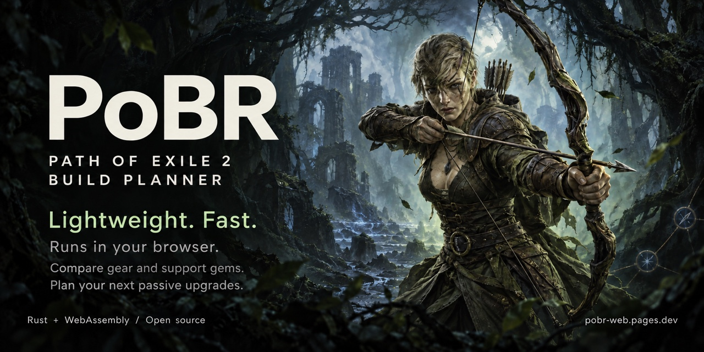

# PoBR — Path of Exile 2 Build Planner

**English** | [简体中文](README.zh-CN.md)

[](https://pobr.win)

**Compare gear, support gems and passive upgrades before changing your build.**

PoBR (Path of Building in Rust) is an open-source **Path of Exile 2 build planner
that runs in your browser**. Import a PoB2 build code or WeGame share link, inspect
your damage and defences, and preview your next upgrade. Powered by Rust and
WebAssembly, with English, Simplified Chinese and Traditional Chinese interfaces.

**[Try PoBR in your browser](https://pobr.win)** ·
[Pages fallback](https://pobr-web.pages.dev) ·
[Release notes](https://github.com/ackness/pobr/releases) ·
[Report a problem](https://github.com/ackness/pobr/issues)

> **Beta:** ready to try, with incomplete game-mechanic coverage. Check unsupported
> effects and combat settings before relying on an upgrade comparison.

## The current app

| Equipment and live character stats | Compare complete items |
| --- | --- |
| [](docs/screenshots/equipment.png) | [](docs/screenshots/item-comparison.png) |
| **Inspect skill groups and support gems** | **Inspect the allocated passive tree** |
| [](docs/screenshots/support-upgrades.png) | [](docs/screenshots/passive-tree.png) |

Captured from the live site with ego-lite on October 30, 2026, using release
v0.0.43 and a public regression build. The screenshots show the Simplified Chinese
interface. They illustrate the app, not a recommended build.
[Capture details and more views](docs/screenshots/README.md).

## What you can do

- **Compare an item before buying.** Paste a complete item copied from the market
  and see its effect on damage per second (DPS), effective hit pool (EHP) and
  resistances across compatible equipment slots.
- **Find support combinations for your skill.** Compare evaluated gem sets,
  exclude supports you do not want to use, and preview level or quality upgrades.
- **Plan your next passive points.** Explore connected routes that include travel
  costs, preview node changes, then apply a plan when you choose.
- **Search the market for your build.** Generate official PoE2 market links with
  relevant affix weights, character-level requirements and a budget filter.
- **Understand the numbers.** Inspect damage breakdowns and modifier sources while
  editing equipment, skills and combat configuration.

## Try it with your build

1. [Open the web app](https://pobr.win), then choose **Build library** in the top
   bar, or **Import or create a build** on the empty Overview.
2. Paste a **PoB2 build code** or a **WeGame PoE2 share link** and import it.
   You can also import supported build-share links or a `.build` file, or start
   a new character.
3. Check your main skill, combat configuration and unsupported effects, then use
   **Upgrades**, **Skills** or **Tree** to compare changes.

The site root opens the workbench. **Settings** offers game-style, grouped and
compact displays, with page-specific overrides, language, theme and spacing
controls. Display choices do not change the calculation.

Edits are saved in your browser, with separate builds and stages. Importing a
build code adds a new build by default; choose the current stage as the import
destination only when you want to replace that stage. Tabs on the same origin
coordinate library changes. **`pobr.win` and `pobr-web.pages.dev` keep separate
local saves**; use a file to move builds between them.

Share a build with all its stages as JSON, or export a PoB2 build code. Download
a workspace backup to keep every build, stage and unapplied editor draft or move
devices. Restoring that backup replaces the whole local collection after
confirmation, so back up your current workspace before restoring another one.

Import formats carry different information: an in-game planner file does not
contain a complete equipped character. [See what each format preserves](docs/import-formats.md).

PoBR calculates a build under your selected conditions. It does not replay a fight
or infer rotations, trigger history or buff uptime. EHP depends on the configured
enemy and incoming damage. [Mechanics and assumptions](docs/mechanics/README.md)
explain the limits.

PoBR is an independent implementation using
[Path of Building for PoE2](https://github.com/PathOfBuildingCommunity/PathOfBuilding-PoE2)
as its calculation reference. It does not yet reproduce every PoB2 mechanic.
Recommendations cover evaluated candidates and modeled effects; market weights
help shortlist items and do not guarantee the best purchase. Compare the complete
item before buying.

## Contribute and follow along

Found a calculation mismatch or an unsupported modifier?
[Open an issue](https://github.com/ackness/pobr/issues/new) with a minimal build
you can share publicly, the relevant item or skill, and expected versus actual
results. UI feedback and translation corrections are welcome too.

For implementation work, start with [the contributor guide](CONTRIBUTING.md) or
[adding modifier rules](docs/contributing-mods.md). If PoBR is useful to you,
**star the repository** to bookmark it, or use **Watch → Custom → Releases** for
release notifications.

## For developers

The calculation engine is written in Rust and shared by the WebAssembly app and
CLI. Modifier parsing supports offline precompilation; calculation tracing and
source attribution are exposed through `TraceGraph` and `AttributionReport`.
Stable IDs separate calculation from translated display text, and versioned
JSON snapshots supply game data. PoB2 parity tests guard the recorded regression
baseline; they do not imply complete mechanic coverage.

Calculation runs locally in the browser; WeGame and market HTTP adapters use a
Pages Worker. The WASM/JSON API and CLI are still evolving and may change
between releases.

### Run locally

Use the latest stable [mise](https://mise.jdx.dev/getting-started.html) to install
and run the project-pinned tools. From the repository root:

```bash
mise bootstrap --only packages,tools,task
mise exec -- cargo run -p pobr-cli -- calculate --base-life 1000 --mod "+50 to maximum Life"
mise run verify build codec           # Optional focused test/lint check
mise run targets                      # List suites without compiling
```

For the web app, follow the [web setup guide](web/README.md) to prepare WASM and
game data and start Vite. The [development workflow](docs/development-workflow.md)
explains focused validation, CI, reviews and releases. See the
[WASM package guide](docs/wasm-package.md#runtime-performance-comparison) for
optional performance measurements and their limits.

Rust **edition 2024**; apps and tools inherit the workspace release version.
The seven internal libraries keep independent versions.

## Documentation

| I want to… | Start here |
| --- | --- |
| Find a guide | [Documentation index](docs/README.md) |
| Contribute code | [CONTRIBUTING.md](CONTRIBUTING.md), [AGENTS.md](AGENTS.md), [maintainer guide](docs/maintainer-guide.md) |
| Add or fix a modifier | [Modifier guide](docs/contributing-mods.md), [change recipes](docs/recipes.md) |
| Understand the API | [Build model](docs/build-model.md), [calculation outputs](docs/calc-outputs.md), [WASM package](docs/wasm-package.md) |
| Check mechanics | [Mechanics](docs/mechanics/README.md), [deliberate differences](docs/pob2-differences.md) |

The workspace has seven Rust libraries, two apps and four Rust tools. The React /
TypeScript app lives in `web/`. The maintainer guide describes the architecture
and data flow. Historical research in `agent-docs/` needs checking against current
game data and tests; it is not the current behavior contract.

## References & acknowledgements

- [PathOfBuildingCommunity/PathOfBuilding-PoE2](https://github.com/PathOfBuildingCommunity/PathOfBuilding-PoE2)
  (MIT) supplies reference data and regression comparisons. Game data and item
  wording define the intended rules. The pinned Lua checkout under `vendor/` is
  a cross-check, not the authority when it disagrees with game evidence.
  [Remaining dependencies](docs/pob2-differences.md).
- [poe2db.tw](https://poe2db.tw/) and the PoE2 Wiki — sources for game
  mechanics and text translations.

## License

The code is released under the [MIT](LICENSE) license.

This project is not affiliated with or endorsed by Grinding Gear Games. The
game data under `data/` is derived from Path of Exile 2 client assets and is
copyrighted by Grinding Gear Games; it is included solely for build-calculation
interoperability, in line with Path of Building community practice.
