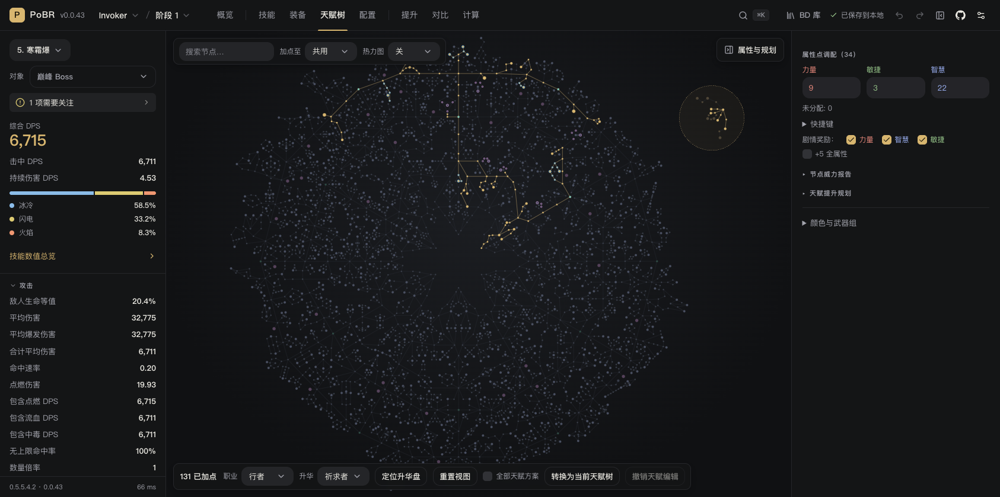

# PoBR — Path of Exile 2 Build Planner

**English** | [简体中文](README.zh-CN.md)

**Compare gear, support gems and passive upgrades before changing your build.**

PoBR (Path of Building in Rust) is an open-source **Path of Exile 2 build planner
that runs in your browser**. Import a PoB2 build code or WeGame share link, inspect
your damage and defences, and preview your next upgrade. Powered by Rust and
WebAssembly, with English, Simplified Chinese and Traditional Chinese interfaces.

**[Try PoBR in your browser](https://pobr-web.pages.dev)** ·
[Release notes](https://github.com/ackness/pobr/releases) ·
[Report a problem](https://github.com/ackness/pobr/issues)

> **Beta:** ready to try, with incomplete game-mechanic coverage. Check unsupported
> effects and combat settings before relying on an upgrade comparison.

## See your next upgrade

| Equipment and live character stats | Compare items and simulate affix tiers |
| --- | --- |
| [](docs/screenshots/equipment.png) | [](docs/screenshots/item-comparison.png) |
| **Filter unwanted supports and compare combinations** | **Preview connected passive upgrades** |
| [](docs/screenshots/support-upgrades.png) | [](docs/screenshots/passive-tree.png) |

Click any image to enlarge. Screenshots use a synthetic demonstration character,
not a build guide.

## What you can do

- **Compare an item before buying.** Paste a complete item copied from the market
  and see its effect on damage per second (DPS), effective hit pool (EHP) and
  resistances across compatible equipment slots.
- **Find support combinations for your skill.** Compare evaluated gem sets,
  exclude supports you do not want to use, and preview level or quality upgrades.
- **Plan your next passive points.** Explore connected routes that include travel
  costs, preview node changes, then apply a plan when you choose.
- **Search the market for your build.** Generate official PoE2 market links with
  relevant affix weights, character-level requirements and a budget filter.
- **Understand the numbers.** Inspect damage breakdowns and modifier sources while
  editing equipment, skills and combat configuration.

## Try it with your build

1. [Open the web app](https://pobr-web.pages.dev) — no desktop installation needed.
2. On **Build**, paste a **PoB2 build code** or a **WeGame PoE2 share link** and
   import it. You can also import a `.build` file or start a new character.
3. Check your main skill, combat configuration and unsupported effects, then use
   **Upgrades**, **Skills** or **Tree** to compare changes.

Edits are saved in your browser, with separate builds and stages. Importing a
build code adds a new build by default; choose the current stage as the import
destination only when you want to replace that stage.

Share a build with all its stages as JSON, or export a PoB2 build code. Download
a workspace backup to keep every build, stage and unapplied editor draft or move
devices. Restoring that backup replaces the whole local collection after
confirmation, so back up your current workspace before restoring another one.

PoBR is an independent implementation using
[Path of Building for PoE2](https://github.com/PathOfBuildingCommunity/PathOfBuilding-PoE2)
as its calculation reference. It does not yet reproduce every PoB2 mechanic.
Recommendations cover evaluated candidates and modeled effects; market weights
help shortlist items and do not guarantee the best purchase. Compare the complete
item before buying.

## Contribute and follow along

Found a calculation mismatch or an unsupported modifier?
[Open an issue](https://github.com/ackness/pobr/issues/new) with a minimal build
you can share publicly, the relevant item or skill, and expected versus actual
results. UI feedback and translation corrections are welcome too.

For implementation work, start with [the contributor guide](AGENTS.md) or
[adding modifier rules](docs/contributing-mods.md). If PoBR is useful to you,
**star the repository** to bookmark it, or use **Watch → Custom → Releases** for
release notifications.

## For developers

The calculation engine is written in Rust and shared by the WebAssembly app and
CLI. Modifier parsing supports offline precompilation; calculation tracing and
source attribution are exposed through `TraceGraph` and `AttributionReport`.
Stable IDs separate calculation from translated display text, and versioned
JSON snapshots supply game data. PoB2 parity tests guard the recorded regression
baseline; they do not imply complete mechanic coverage.

Calculation runs locally in the browser; WeGame and market HTTP adapters use a
Pages Worker. The desktop application is currently a placeholder. The WASM/JSON
API and CLI are still evolving and may change between releases.

### WASM performance: PoBR vs pob-web

The opt-in benchmark runs **real PoBR Rust WASM** and
[pob-web's Lua WASM](https://github.com/krauthaufen/pob-web), using the same
committed PoB2 build codes. It measures **code import + calculation + JSON
response**, not a cached stat read or an isolated calculation kernel.

Measured on **2026-10-11**, Apple M1 Pro / macOS arm64, Node **26.10.0**;
PoBR `d60488f`, release WASM, schema 7, data `4.5.5.3`:

#### Latest season: Forbidden Rites

Eight public builds were captured from [poe.ninja's latest season](https://poe.ninja/poe2/builds/forbiddenrites)
on **2026-10-11**, snapshot `0632-20261011-47556`, one per base class.
[Selection and source evidence](examples/wasm-benchmark/selection.json) records the
index URLs, characters and hashes. Candidates were chosen before timing: one
declared ascendancy filter per class, then the lexicographically first public
account/character among that filter's first 100 index rows. Failed candidates
were not replaced. The [new fixtures](examples/wasm-benchmark/builds/) are separate
from the older parity corpus and are not new numerical goldens.

Times are milliseconds; speedup is **Lua / Rust time**. Each completed build has
nine measured samples; p95 uses nearest rank (the maximum of nine samples).

| Class / ascendancy / main skill | PoBR median | Lua median | Speedup | PoBR p95 | Lua p95 | p95 ratio |
| --- | ---: | ---: | ---: | ---: | ---: | ---: |
| Druid / Oracle / Lightning Bolt — Lua error | — | — | — | — | — | — |
| Huntress / Amazon / Ice Shot | 11.05 | 773.07 | 69.95× | 11.86 | 1144.06 | 96.49× |
| Mercenary / Gemling Legionnaire / Comet — Lua error | — | — | — | — | — | — |
| Monk / Martial Artist / Ice Shot | 11.18 | 793.01 | 70.92× | 14.02 | 815.01 | 58.14× |
| Ranger / Deadeye / Ice Shot — Lua error | — | — | — | — | — | — |
| Sorceress / Stormweaver / Comet — Lua error | — | — | — | — | — | — |
| Warrior / Titan / His Scattering Calamity — Lua error | — | — | — | — | — | — |
| Witch / Blood Mage / Impending Doom — Lua error | — | — | — | — | — | — |

The six latest-season failures are Lua `CalcDefence.lua` `s_format` range errors.
They have no speed ratio. **The completed builds also have materially different
outputs and incomplete PoBR coverage**, so these are API-workload timings—not an
equivalent-mechanics or universal engine-speed comparison:

| Completed latest-season build | PoBR TotalDPS | Lua TotalDPS | PoBR unsupported modifiers |
| --- | ---: | ---: | ---: |
| Amazon / Ice Shot | 88,117.54 | 237,926.57 | 26 |
| Martial Artist / Ice Shot | 2,877,759.58 | 5,173,634.32 | 13 |

Both completed latest-season builds report zero item parse errors.

<details>
<summary>Historical comparison cohort: 7 builds</summary>

These are older Runes of Aldur captures, not latest-season builds. At the user's
request, 11 previously failing/unstable historical builds were removed from the
performance cohort, not from the shared parity regression fixtures. This cohort
is selected after observing the earlier run and is not an unbiased historical sample.

| Class / ascendancy / main skill | PoBR median | Lua median | Speedup | PoBR p95 | Lua p95 | p95 ratio |
| --- | ---: | ---: | ---: | ---: | ---: | ---: |
| Huntress / Spirit Walker / Twister | 11.69 | 726.38 | 62.16× | 12.49 | 905.85 | 72.55× |
| Mercenary / Gemling Legionnaire / Explosive Grenade | 9.23 | 779.69 | 84.50× | 10.08 | 1228.82 | 121.89× |
| Ranger / Deadeye / Explosive Grenade | 8.18 | 653.80 | 79.97× | 8.55 | 680.15 | 79.58× |
| Ranger / Pathfinder / Ice Shot | 10.30 | 561.06 | 54.46× | 11.07 | 586.64 | 53.01× |
| Warrior / Smith of Kitava / Shield Wall | 8.96 | 922.45 | 102.92× | 10.61 | 1502.46 | 141.60× |
| Warrior / Titan / Shield Wall | 10.49 | 664.66 | 63.35× | 10.80 | 686.03 | 63.54× |
| Witch / Abyssal Lich / Detonate Dead | 14.35 | 634.40 | 44.21× | 14.97 | 1948.49 | 130.16× |

</details>

| Initialization: single observation | PoBR (ms) | Lua (ms) | Lua / Rust |
| --- | ---: | ---: | ---: |
| Engine and data boot | 715.65 | 2579.03 | 3.60× |

#### Measurement limits

Each build gets two untimed warmups; measured calls alternate engine order.
Unique legal JSON whitespace bypasses PoBR's exact-request response cache.
Code inflation is timed on both sides. Lua timings include Node Worker transport,
adapter checks and headless UI-state construction; PoBR returns a different,
more detailed JSON contract. Initialization excludes artifact reads/hash checks
and Lua host-worker creation, but includes module import, data staging and boot.
There is no browser rendering, download, incremental-edit or runtime-memory test.

All **15 selected builds** are retained in the report: **9 completed comparisons**
and **6 rejected latest-season cases**. The benchmark rejects swallowed Lua errors, partial results
and unstable repeated outputs rather than scoring them as fast calculations.
It exits nonzero if any fixture fails. Performance does **not** prove mechanic
coverage or numerical parity; unsupported-modifier and item diagnostics are preserved.

[Recorded samples, diagnostics and artifact hashes](devs/ci/pob-web-performance-baseline.json)
identify this observation. The deployed Lua/JS/data were downloaded from
`pob.awx.at`; their source revision is unknown. Wrapper/shims/loading patches
are pinned separately to upstream `ee33ce6`. Keep the hash-verified reference
snapshot to rerun the same artifacts; a fresh download may measure a newer deployment.

#### Package size

Actual byte measurements of the same engine/data artifacts; **MiB = 1,048,576 bytes**.
Data is gzip level 9. The transfer estimate also gzip-compresses WASM and JS,
without recompressing the data gzip.

| Component / scope (MiB) | PoBR | pob-web | PoBR / Lua size |
| --- | ---: | ---: | ---: |
| WASM, raw | 4.891 | 0.250 | 19.56× |
| JavaScript, raw | 0.023 | 0.066 | 0.34× |
| Compressed data bundle | 4.286 | 4.633 | 0.93× |
| WASM + JS + compressed data | 9.200 | 4.949 | 1.86× |
| gzip transfer estimate | 6.072 | 4.763 | 1.27× |

**PoBR's current runtime bundle is larger, not smaller.** It compiles the Rust
engine into WASM; Lua's smaller WASM is an interpreter whose calculation code
travels in the data bundle. Dataset contents, localization and supported
mechanics differ. These sizes do not measure runtime memory.
The complete PoBR release archive is approximately **6.058 MiB**, including
types, docs, a demo and the agent skill; the reference deployment has no matching
release archive to compare.

[Measured Lua size baseline](devs/ci/pob-web-wasm-size-baseline.json) records hashes,
dates and compression settings. Generate the size reports and exercise the package:

```bash
node web/scripts/measure-pob-web-size.mjs --output devs/ci/pob-web-wasm-size-baseline.json
pnpm --dir web package-wasm
pnpm --dir web smoke-wasm-package
node --test web/scripts/measure-pob-web-size.test.mjs web/scripts/package-wasm.test.mjs
# .cache/wasm-release/wasm-size.json and wasm-size.md
```

#### Reproduce and test

From the repository root, with Node 22+, stable Rust, wasm-pack and pnpm:

```bash
pnpm --dir web build-wasm
pnpm --dir web sync-data
node web/scripts/benchmark-pob-web.mjs --prepare
node web/scripts/bench-pob-web.mjs --iterations 9 --warmup 2
# The recorded run has rejected cases: exit 1, but a complete report is written.
# Raw samples, full responses, diagnostics, host and provenance:
# .cache/pob-web-performance.json
node web/scripts/snapshot-pob-web-benchmark.mjs
# Compact committed baseline plus Markdown rows printed to stdout.

# Network-independent regression tests (no Rust build or downloaded Lua needed):
node --test web/scripts/benchmark-comparison.test.mjs web/scripts/benchmark-builds.test.mjs web/scripts/benchmark-pob-web.test.mjs
```

The committed builds can be benchmarked offline once WASM/data and the Lua
reference snapshot are prepared. For online acquisition or replay, Python 3
and curl are also required:

```bash
# Discover the site's latest season and preselect one public build per base class.
python3 web/scripts/fetch-ninja-benchmarks.py --selection base-class-first-v1
# Replay the recorded season/snapshot/candidates into a separate capture directory.
python3 web/scripts/fetch-ninja-benchmarks.py \
  --selection-file examples/wasm-benchmark/selection.json \
  --output .cache/ninja-replay/builds --manifest .cache/ninja-replay/selection.json
python3 -m unittest discover -s web/scripts -p 'fetch_ninja_benchmarks_test.py'
```

The collector preserves source URLs, snapshot, fetch date, exported XML identities
and code hashes; retired upstream snapshots cause a visible replay failure.
It never adds captures to the parity golden corpus or replaces a failed candidate.

The [reference preparation/adapter](web/scripts/benchmark-pob-web.mjs),
[measurement harness](web/scripts/benchmark-comparison.mjs) and
[executable runner](web/scripts/bench-pob-web.mjs) are complete source scripts.
Preparation downloads actual engine/data plus the pinned upstream source and
license, then verifies cached hashes on subsequent offline runs. Partial or
tampered snapshots fail rather than being silently repaired. Use
`--directory <new-dir>` when preparing a different snapshot, and
`--reference-dir <new-dir>` when measuring it; `--help` lists all options.
Tests cover statistics, option boundaries, cache-busting call identity,
repeat stability, error/partial-result rejection, safe template extraction and
provenance tampering. Benchmarks remain opt-in; wall-clock speed is not a CI gate.

### Run locally

For the web app, follow the [web setup guide](web/README.md) to prepare WASM and
game data and start Vite. To try the CLI, run from the repository root with the
installed stable Rust toolchain:

```bash
# CLI (binary name: pobr)
cargo run -p pobr-cli -- calculate --base-life 1000 --mod "+50 to maximum Life"
cargo run -p pobr-cli -- decode-code <pob_code>        # PoB build code -> XML
cargo run -p pobr-cli -- parse-mod "20% increased Fire Damage"
```

For changes, select checks for the affected behavior. For example, validate
Build Code changes with:

```bash
mise run verify build codec
mise run targets                     # List suites without compiling
mise run timings build parity        # Compile one suite and report timings
```

Normal local commits use relevant checks. Full gates run in cloud CI: push a
release tag, or request a branch run with `mise run ci <pushed-ref>`. No duplicate
local full run is required. `mise run full` remains available for local Rust
validation. Pull requests run lightweight checks automatically; see
[CONTRIBUTING.md](CONTRIBUTING.md). The live app deploys from `v0.x` release tags after all CI jobs pass.
See [development workflow](docs/development-workflow.md) for commands, cache reuse,
storage reporting and timing.

Rust **edition 2024**; apps and tools inherit the workspace release version.
The seven internal libraries keep independent versions, so application version
bumps do not invalidate the entire library dependency chain.

## Architecture at a glance

Data flow:

```
GGG .dat export
  └─(pobr-data-adapter, offline)→ data/<version>/*.json
       └─(pobr-gamedata, runtime loader)→ calculation layers
```

Calculation pipeline (`pobr-core`):

```
modifier text → parse → ModDb → aggregation queries → calc
  → OutputTable + Breakdown + TraceGraph + AttributionReport
```

Standard stat aggregation: `(base + Σbase) * (1 + Σinc/100) * Π(1 + more/100)`.

Game-data file loading is confined to `pobr-gamedata`; production `pobr-data` /
`pobr-core` do not read data files. Test rule loading requires an explicit test
feature. Apps and tools own network and file input/output; `pobr-data` remains
the bottom project dependency.

Core sources are layered into `model/`, `parse/`, `rules/`, `ingest/`,
`aggregate/`, `calc/`, and `attribute/`. Web's `api/wasmBackend.ts` calls the JSON
contract in `apps/pobr-wasm/src/build_api/`; startup fetches and stages data into
in-memory `GameData` / `BuildData`.

## Workspace layout

14 members: seven libraries in `crates/`, three application entry points in
`apps/`, and four Rust tools in `tools/`. The React/TypeScript `web/` application
and Lua oracle are outside the Cargo workspace.

| Crate | Responsibility |
|-------|----------------|
| `crates/pobr-data` | Pure data definitions (catalog schema: BaseItem/Stat/Mod/SkillGem/PassiveNode…); zero logic, zero I/O; bottom dependency of every crate |
| `crates/pobr-core` | Modifier parsing / storage / aggregation + calculation engine + source-level attribution + source ingestion (item/passive/gem/flask). Zero I/O |
| `crates/pobr-gamedata` | Runtime data loader — the only layer in the data system that touches files; lazy per-domain loading + i18n sidecars |
| `crates/pobr-i18n` | Language pack loading / fallback / display-text mapping (`en-US` canonical + `zh-TW`) |
| `crates/pobr-tree` | Passive tree topology, allocated-node mod collection, radius jewels |
| `crates/pobr-build` | Build state, PoB build code encode/decode, import recognition, `calc_orchestrator/` + `CalcCache`, build comparison. **Home of the parity tests** |
| `crates/pobr-item` | Full-fidelity edit-mode parsing of raw item text + reverse serialization (BuildRaw round-trip) |
| `apps/pobr-cli` | CLI: `calculate` / `parse-mod` / `decode-code` / `encode-code` |
| `apps/pobr-wasm` | Web/WASM API: pure-Rust JSON in/out; wasm-bindgen bindings behind the `wasm` feature |
| `apps/pobr-desktop` | Example calculation and text summary placeholder; no GUI framework yet |
| `tools/pobr-data-adapter` | Data pipeline adapter: GGG `.dat` export → denormalized committed JSON |
| `tools/sync-pob-catalog` | Extracts the stat catalog from PoB core Lua; parity check / diff |
| `tools/lint-i18n` | Language pack completeness check |
| `tools/precompile-mods` | Offline pre-compilation of mod-parser rules / coverage report |

(`tools/pob2-oracle` is a non-workspace pure-Lua wrapper that dumps PoB2-side
calculation breakdowns for per-component comparison.)

## Parity system (regression baseline)

PoB2 compatibility is a hard regression gate, guarded by three complementary
layers:

1. **`crates/pobr-build/tests/parity/ninja_parity.rs`** — walks real PoB2 builds with
   golden stat values, comparing all classes / skills with zero hard-coding;
   `parity_no_regression` asserts the aggregate hit rate never drops below the
   recorded baseline.
2. **golden / dual-run suites** — modules under `tests/parity/` and
   `tests/dualrun/` pin intermediate values and config semantics; Cargo runs
   their aggregate targets `parity.rs` and `dualrun.rs`.
3. **`tools/pob2-oracle`** — when a divergence needs per-component diagnosis,
   dumps the Lua-side calculation breakdown straight from the vendored PoB2.

```bash
mise run test build parity parity_baseline_report -- --ignored --nocapture
```

`vendor/PathOfBuilding-PoE2/` is a full checkout; verify formulas by reading
the local Lua directly instead of searching online.

## Documentation

- [`AGENTS.md`](AGENTS.md) — concise contributor guide and development entry points.
- [`CLAUDE.md`](CLAUDE.md) — verification tiers, command cheat-sheet, key
  conventions (read before contributing).
- [`agent-docs/`](agent-docs/) — PoE2 (0.5.0) game-mechanics reference in
  Chinese (damage types / resistances / armour, evasion, ES / crit / ailments /
  damage-defence order, …).
- [`web/README.md`](web/README.md) — web frontend.

Early `devs/docs/architecture/00–16` designs and audits are optional local history;
committed documents 18–21 cover feature contracts. Historical snapshots are not
current task lists or fresh-checkout prerequisites. Use code, CLAUDE.md, and
relevant tests for current behavior.

## Conventions

- **Only stable IDs inside the calculation** (`StatId` / `ModName` /
  `SourceId`); display text goes through `pobr-i18n`.
- **Immutable / deterministic**: mutable writes to `Env` are concentrated in
  `perform`; parallelism only fans out over read-only snapshots.
- Changes touching calculation / modifiers / the parser need matching
  integration tests or golden fixtures; changes to crate boundaries,
  aggregation semantics, catalog or parity rules must update the architecture
  docs in the same change.

## References & acknowledgements

- [PathOfBuildingCommunity/PathOfBuilding-PoE2](https://github.com/PathOfBuildingCommunity/PathOfBuilding-PoE2)
  (MIT) — the reference implementation and parity baseline of this project:
  calculation formulas, modifier semantics and specialModList parsing rules are
  verified one-by-one against its Lua implementation (checked out locally under
  `vendor/`, not committed; the pinned commit is recorded in
  `data/<version>/overlay/mod_parser_rules.json::_meta`).
- [poe2db.tw](https://poe2db.tw/) and the PoE2 Wiki — sources for game
  mechanics and text translations.

## License

The code is released under the [MIT](LICENSE) license.

This project is not affiliated with or endorsed by Grinding Gear Games. The
game data under `data/` is derived from Path of Exile 2 client assets and is
copyrighted by Grinding Gear Games; it is included solely for build-calculation
interoperability, in line with Path of Building community practice.
